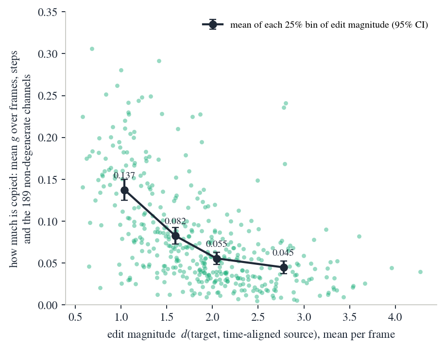
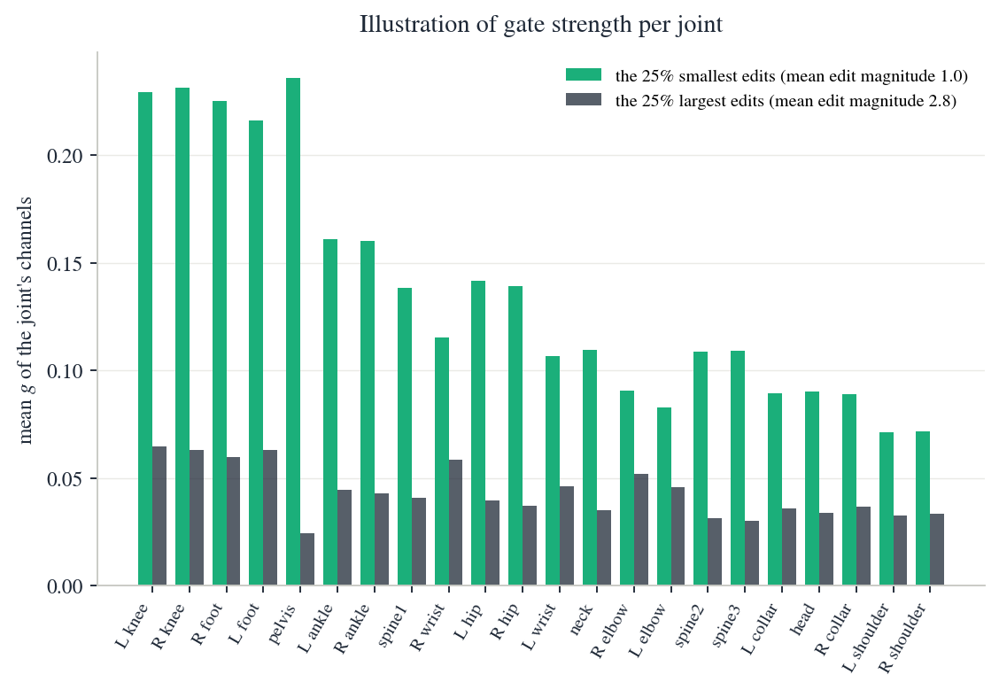

<p align="center">
<strong>SuperMotion: Source-Preserving Denoising for Text-Driven Human Motion Editing</strong>
  <p align="center">
    <a href='https://github.com/harlanhong' target='_blank'>Fa-Ting Hong</a>&emsp;
    <a href='https://peterwonka.net/' target='_blank'>Peter Wonka</a>&emsp;
    <br>
    KAUST
  </p>
</p>

<p align="center">
  <a href='https://arxiv.org/abs/2610.01517'>
    </a>
  <a href='https://github.com/harlanhong/SuperMotion'>
    </a>
</p>

Given a **source motion** and an **edit instruction**, SuperMotion produces the edited motion while
preserving everything the instruction does not ask to change. The denoiser is a v-prediction DiT with
U-ViT long skip connections and a **preservation field** g ∈ (0,1)^(T×D): at every reverse step the
clean-motion estimate is re-anchored to the time-aligned source,

```
x̂₀* = x̂₀ + g ⊙ (align(source) − x̂₀)
```

in clean-motion space, never in v-space, where the correction would be divided by √(1−ᾱₜ). The field is
trained by a single source-anchor loss and needs no localisation labels.

<div align="center">

| How much is copied | Which joints are copied |
|---|---|
|  |  |

</div>

The field copies as much as the edit allows: on the smallest quarter of edits it reuses 3.1× more of the
source than on the largest. Lower-body joints are copied most and arms least, at every edit size.

> This repository contains the **inference code and the released checkpoint**. Training code is not included.

## Results

MotionFix, TMR retrieval, generated → target. **B** = within batches of 32, **F** = over the full test pool.
AvgR is better when lower.

| | B R@1 | B R@2 | B R@3 | B AvgR | F R@1 | F R@2 | F R@3 | F AvgR |
|---|---|---|---|---|---|---|---|---|
| SimMotionEdit (CVPR'25) | 70.62 | 82.92 | 88.12 | 2.38 | 25.49 | 39.33 | 49.21 | 23.49 |
| OmniME (CVPR'26) | 77.29 | 88.54 | 91.88 | 1.79 | 32.02 | 50.20 | 59.88 | 13.06 |
| **SuperMotion** (paper) | **79.17** | **89.17** | **92.92** | **1.68** | **33.20** | **50.79** | 59.09 | **12.87** |
| SuperMotion — reproduced with this code | 78.96 | 89.58 | 92.50 | 1.71 | 33.60 | 49.41 | 59.29 | 13.16 |

The last row is what `python evaluate.py folder=checkpoints/supermotion_release` produces here, on one
A100. It differs from the paper row only through the noise draw ([Reproducibility](#reproducibility));
repeated runs of this code with the same settings are bit-identical. The same run gives dynamics ratios
of 0.84 (root) / 0.92 (velocity) / 0.90 (high frequency) against the ground truth, and a per-sequence
detail ratio of 1.02 where 1.0 is the ground truth.

## Environment Setup

Tested with Python 3.10, PyTorch 2.1.2 + CUDA 11.8; inference needs about 8 GB of GPU memory.

```bash
git clone https://github.com/harlanhong/SuperMotion.git && cd SuperMotion
bash scripts/install.sh          # creates ./mfix-env with the pinned dependencies
source mfix-env/bin/activate
```

`requirements-lock.txt` is the exact environment behind every number above. If you build your own, keep
`transformers==4.17` together with `huggingface-hub==0.17.3`; newer hub releases break that transformers.

Follow [motionfix](https://github.com/atnikos/motionfix) for the dataset, or use the helper:

```bash
bash scripts/download_data.sh    # MotionFix dataset, TMR evaluator, SMPL-H bodies, CLIP text encoder
```

Expected layout:

```
data/motionfix-dataset/       motionfix.pth.tar, motionfix_test.pth.tar, splits.json, ...
data/body_models/smplh/       SMPL-H neutral body model
data/scores_v3.npz            source-target similarity curves (from the SimMotionEdit release)
deps/clip-vit-large-patch14/  CLIP text encoder (openai/clip-vit-large-patch14)
deps/stats/statistics_motionfix.npy
eval-deps/                    TMR retrieval evaluator
```

## Checkpoint

```bash
mkdir -p checkpoints && cd checkpoints
wget https://github.com/harlanhong/SuperMotion/releases/download/v1.0/supermotion_release.tar.gz
tar xzf supermotion_release.tar.gz && cd ..
```

This gives `checkpoints/supermotion_release/` with the run config and `checkpoints/last.ckpt`. The file
is 186 MB rather than 2.2 GB because the frozen CLIP text encoder is not duplicated into it; it is loaded
from `deps/clip-vit-large-patch14`, so run `download_data.sh` first.

Check the installation end to end with `bash scripts/selftest.sh` (a few minutes).

## Editing a motion

```bash
# the instruction that ships with the motion
python edit.py folder=checkpoints/supermotion_release keyid=000038

# your own instruction, several source motions at once
python edit.py folder=checkpoints/supermotion_release 'keyid=[000038,000091]' \
    text="raise both arms much higher" out_dir=outputs
```

Source motions are MotionFix test/val motions, addressed by id. For each one you get

| file | contents |
|---|---|
| `<keyid>.npy` | `{'pose', 'pose_source', 'pose_target', 'text'}`, each `(T, 135)`: 3 translation + 6D root orientation + 21 joints × 6D |
| `<keyid>.npz` | the generated motion as SMPL-H parameters: `trans (T,3)`, `global_orient (T,3)`, `body_pose (T,63)`, axis-angle, 30 fps |

The 6D rotations the network outputs are not exactly orthonormal; they are projected onto SO(3) for the
`.npz`, which is the file to render.

## Evaluation

#### Step 1: Extract the samples
```bash
python evaluate.py folder=checkpoints/supermotion_release
```

#### Step 2: Compute the metrics
```bash
S=$PWD/checkpoints/supermotion_release/3way_steps_300_motionfix_noise_last/ld_txt-3.0_ld_mot-3.0
python compute_metrics.py folder=$S
python scripts/dyn_ratio.py release=$S                 # dynamics ratios against the ground truth
python scripts/diag_copy_vs_edit_any.py release=$S     # copy-vs-edit diagnostic
```

Step 1 samples the 836 evaluation motions (506 test + 330 val) in about 25 minutes on an A100 and writes
one `.npy` per motion; step 2 scores the test ids among them.

Useful overrides:

| override | meaning |
|---|---|
| `guidance_scale_text_n_motion`, `guidance_scale_motion` | classifier-free guidance weights (default 3.0 / 3.0) |
| `field_scale` | strength of the preservation field at inference; 1.0 = as trained |
| `batch_size`, `max_samples` | batching; stop after N motions, for a quick check |
| `out_tag` | suffix for the output folder, to keep several settings side by side |

`field_scale` is a dial between editing and copying. Raising it keeps more of the source: retrieval
against the target rises (34.6 at ×4 versus 33.2 at ×1), but retrieval against the *source* rises faster
(46.6 versus 38.5), so the extra top-1 is copying rather than editing. The paper reports ×1.

## Reproducibility

MotionFix evaluates on **half of the test split**. Upstream draws that half from the global Python RNG at
the moment the dataset is built, so the evaluated pool depends on anything that consumed randomness
earlier in the process — even the number of log lines printed. This repository instead reads the pool from
`assets/motionfix_test_ids.json`, the 506 motions the paper reports on, and warns when the pool differs.
Set `data.preproc.test_ids_file=null` for the upstream behaviour.

Generation is stochastic. With the fixed pool, a fixed `batch_size` and the seed in the checkpoint config,
repeated runs are identical; changing the batch size changes which noise sample each motion gets and
shifts the metrics by a few tenths of a point.

## Acknowledgements

Implementation builds upon [SimMotionEdit](https://github.com/lzhyu/SimMotionEdit) and
[motionfix](https://github.com/atnikos/motionfix), whose data pipeline and TMR evaluator this code reuses.

## License

Distributed under MIT LICENSE. The motionfix LICENSE is included in the repository. The SMPL-H body
models, the MotionFix dataset, CLIP and the TMR evaluator follow their respective licenses.

## Citation

```bibtex
@article{hong2026supermotion,
      title={SuperMotion: Source-Preserving Denoising for Text-Driven Human Motion Editing},
      author={Fa-Ting Hong and Peter Wonka},
      year={2026},
      eprint={2610.01517},
      archivePrefix={arXiv},
      primaryClass={cs.CV}
}
```
